# PlacePrep — NST Interview Prep Portal

A data-driven placement preparation portal with two core missions:
1. **Helping NST students prepare for technical interviews** at top companies through personalized, company-specific roadmaps, live LeetCode/Codeforces solve verification, interactive practice, and faculty mentorship.
2. **Helping faculty align the B.Tech CS & AI curriculum** with real-world industry hiring patterns and interview expectations via automated gap analysis.

Both use cases are powered by a shared dataset of over **22,750+ interview questions** and **670+ company profiles** scraped and curated from premier tech platforms.

---

## Architectural Highlights

```mermaid
flowchart LR
    B["Browser"] -->|"same origin (cookies preserved)"| W

    subgraph W["Next.js 16 App · :3000 · dashboard/web"]
        direction TB
        R1["/ student portal"]
        R2["/faculty/* portal"]
        R3["/admin/* portal"]
        MW["proxy.ts (edge role gating)"]
    end

    W -->|"rewrites /api/*"| A

    subgraph A["Express 5 API · :4000 · backend"]
        direction TB
        RT["fsRouter — 107 endpoints"]
        SV["services/ · repositories/"]
        MD["models/ (18 Mongoose schemas)"]
    end

    A --> DB[("MongoDB Atlas")]

    style W fill:#172554,stroke:#3b82f6,color:#e2e8f0
    style A fill:#14532d,stroke:#22c55e,color:#e2e8f0
    style DB fill:#431407,stroke:#f97316,color:#e2e8f0
```



### 1. Unified Web Architecture (3 Portals → 1 App)
The legacy architecture consisted of three separate Next.js portal repositories (`student-portal`, `faculty-portal`, `admin-portal`) and a shared library. These were consolidated into a single high-performance Next.js 16 app under [`dashboard/web/`](file:///Users/sourabhsarkarmacois/Desktop/Place_Prep_Sourabh/dashboard/web):
- **Zero Cross-Origin Friction**: Replaces cross-origin URL token passing with secure, same-origin HttpOnly cookies.
- **Edge Role Protection (`proxy.ts`)**: Enforces RBAC at the edge. Users accessing routes outside their assigned role are seamlessly redirected to their respective home portal (`/`, `/faculty`, or `/admin`).
- **Resource Optimization**: Slashes `node_modules` size by over 50% and consolidates dependencies to React 19, Tailwind CSS v4, Lucide React, and SWR.

### 2. Standalone Express 5 API Server
The backend in [`backend/`](file:///Users/sourabhsarkarmacois/Desktop/Place_Prep_Sourabh/backend) runs as an independent Express 5 service on port `:4000`:
- **Filesystem Router (`fsRouter.ts`)**: Dynamically mounts 107 endpoints by scanning `src/routes/`, ensuring static route segments take precedence over dynamic parameters.
- **Web Standard Adapter**: Bridges Express HTTP lifecycles to standard Web Fetch `Request` / `Response` abstractions.
- **Resilient MongoDB Boot**: Non-blocking database connection lifecycle. If MongoDB Atlas experiences network downtime, the API stays running, reports `{"status":"degraded"}` via `/health`, and automatically reconnects once network access is restored.

### 3. Authentication & Verification
- **Google OAuth Restriction**: Google Identity Services (GIS) login strictly restricted to `@nst.rishihood.edu.in` institutional accounts. First-time sign-ins auto-provision student records and sync profile pictures.
- **Live Submission Verification**:
  - Direct integration with the **LeetCode GraphQL API** (`recentAcSubmissionList`) and **Codeforces REST API** (`user.status`).
  - When students complete a coding question, the server verifies that an `Accepted` submission exists for their linked handle before awarding XP.
  - Non-blocking warning modals notify students if their external handle is not yet connected.
- **Interactive MCQs**: Full in-browser quiz mode with instant feedback, explanations, and automatic XP distribution.

---

## Roles and URLs

| Role | URL Prefix | Description & Primary Features |
|---|---|---|
| **Student** | `/` | Personalized roadmaps, weekly progression, LeetCode verification, interactive MCQs, streak/XP analytics, doubt submissions, 1-on-1 session booking. |
| **Faculty** | `/faculty/*` | Curriculum gap analysis matrix, doubt resolution inbox, student progress matrix, mentorship session management, custom roadmap authoring. |
| **Admin** | `/admin/*` | System analytics (engagement, practice, placements), question & company moderation, feature flag toggles, faculty invitations. |
| **Staff** | `/api/staff/*` | Shared endpoints accessible to both Faculty and Admin (e.g. Custom Roadmap Builder). |

---

## What's Built

### Student Experience
- **Adaptive Roadmaps**: Tailored curricula generated from self-assessment ratings (`frequency × weakness`). Week-by-week progression with upcoming week previews.
- **Interactive Practice**: Coding problems with platform badges (LeetCode, Codeforces, HackerRank, GeeksforGeeks), plus native interactive MCQs.
- **Live Solve Verification**: Validates actual competitive programming submissions before awarding XP (Easy: 10, Medium: 25, Hard: 50).
- **Gamification & Heatmaps**: Daily streaks, XP progress bars, GitHub-style activity heatmaps, and batch-wide leaderboards.

### Staff-Authored Custom Roadmaps (Faculty & Admin)
- Multi-company curricula curated by faculty, with drag-and-drop week organization and external LeetCode problem additions.
- **Company Logo Stacks**: Visually distinct overlapping logo badges on roadmap cards indicating all covered companies.
- **Live Follower Sync**: Updates propagate immediately to all student subscribers without erasing question completion records.
- **Safe Unpublish Dialog**: Two-step retirement workflow showing real subscriber counts; choice between retiring (hidden from discovery while existing followers keep progress) or full removal.

### Faculty & Curriculum Intelligence
- **Gap Analysis**: Compares industry interview frequencies against the NST B.Tech CS & AI course syllabus to highlight unaddressed topics.
- **Doubts Inbox & Mentorship**: Threaded doubt-clearing interface filtered by domain and urgency.

---

## Live Data Statistics

| Collection | Count | Description |
|---|---|---|
| **Questions** | 22,759 | 2,284 generic pool questions + 20,475 company-tagged DSA/CS questions |
| **Companies** | 676 | Top product companies, FAANG, high-growth startups, and tech firms |
| **User Roadmaps** | 22+ | Student personalized learning paths |
| **Question Completions** | 373+ | Tracked student solves with XP and platform verification flags |

---

## Getting Started

### Prerequisites
- Node.js >= 20.0.0
- npm >= 10.0.0
- MongoDB Atlas cluster connection string
- Google Cloud OAuth Client ID (authorized for `@nst.rishihood.edu.in`)

### Installation

```bash
# Clone repository
git clone git@github.com:sourabh14022004/Place_Prep_Sourabh.git
cd Place_Prep_Sourabh

# Install dependencies across all workspaces
npm install
```

### Environment Configuration

Configure both workspaces:

```bash
cp backend/.env.example backend/.env.local
cp dashboard/web/.env.example dashboard/web/.env.local
```

Important configuration keys:
- `MONGODB_URI`: MongoDB Atlas connection string (percent-encode special characters in the password, e.g. `@` -> `%40`).
- `JWT_SECRET`: Minimum 32-character secret, **identical in both `backend/.env.local` and `dashboard/web/.env.local`**.
- `API_URL` (web): Points to `http://localhost:4000` (must match `API_PORT` in backend).
- `GOOGLE_CLIENT_ID` / `NEXT_PUBLIC_GOOGLE_CLIENT_ID`: Your Google OAuth 2.0 Web Client ID.

### Running Locally

```bash
# Run both Backend API (:4000) and Web Frontend (:3000) concurrently
npm run dev
```

Open [http://localhost:3000](http://localhost:3000) in your browser.

| Command | Workspace | Description |
|---|---|---|
| `npm run dev` | Root | Starts both Express API (:4000) and Next.js Web (:3000) concurrently |
| `npm run dev:api` | Backend | Starts Express API with hot-reload via `tsx watch` |
| `npm run dev:web` | Web | Starts Next.js frontend with Turbopack |
| `npm run typecheck` | Both | Executes `tsc --noEmit` across backend and web |
| `npm run build` | Both | Compiles backend to `dist/` and creates Next.js production build |

---

## Production Deployment

- **Web Frontend**: Deploy [`dashboard/web`](file:///Users/sourabhsarkarmacois/Desktop/Place_Prep_Sourabh/dashboard/web) to **Vercel**. Set `API_URL` in Vercel to your deployed backend URL.
- **API Server**: Deploy [`backend`](file:///Users/sourabhsarkarmacois/Desktop/Place_Prep_Sourabh/backend) as a persistent Node.js service on **Railway**, **Render**, or **Fly.io** using `npm run start` (health check at `/api/health`).

---

## Repository Structure

```
Place_Prep_Sourabh/
├── backend/                  # Standalone Express 5 API (port 4000)
│   ├── src/
│   │   ├── server.ts         # Server entry point
│   │   ├── app.ts            # Express setup & middleware
│   │   ├── http/             # fsRouter (107 routes) & Web adapter
│   │   ├── routes/           # Role-scoped routes (auth, student, staff, etc.)
│   │   ├── services/         # Business logic (student, auth, custom roadmaps)
│   │   ├── repositories/     # Mongoose data access layers
│   │   ├── models/           # 18 Mongoose schemas
│   │   └── utils/            # JWT, authMiddleware, errors, rate limiter
│   └── scripts/              # Seeders & data backfill utilities
│
├── dashboard/                # Frontend container
│   ├── README.md             # Dashboard architecture transition notes
│   └── web/                  # Unified Next.js 16 app (port 3000)
│       ├── app/              # (app)/ student, faculty/, admin/, login/
│       ├── components/       # Shared UI, logo stacks, modals, role views
│       ├── lib/              # SWR hooks, constants, API client
│       └── proxy.ts          # Edge authentication & role-based proxy
│
├── scrapers/                 # Scrapers and parsers for interview question platforms
├── pipeline/                 # Data normalization & transformation scripts
├── schema/                   # Data model definitions & taxonomy
├── data/                     # Filtered datasets & execution reports
└── docs/                     # System architecture & research documentation
```

---

## License

This project is developed for educational and research purposes at NST (Newton School of Technology). All interview questions and company data are curated from publicly accessible resources.
