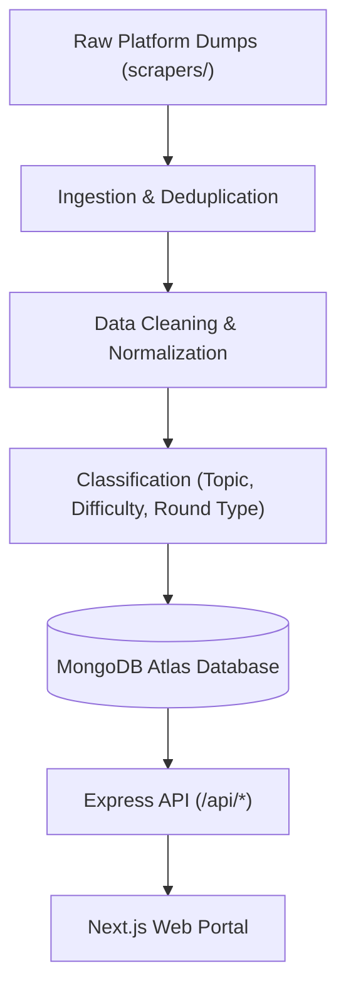

# Pipeline

Data ingestion, normalization, deduplication, and transformation pipeline for PlacePrep's interview intelligence dataset.

---

## Overview

The PlacePrep data pipeline transforms raw interview dumps from dozens of platforms into structured questions, company profiles, and topic frequencies stored in **MongoDB Atlas**.

---

## Ingestion Architecture & Status

1. **Scraped Ingestion**: Platform data collected by scrapers (e.g., `scrapers/group-a`) is parsed and staged.
2. **Deduplication**: Records are deduplicated by checking matching company, round type, and fuzzy problem similarity (>= 90%) or identical canonical source URLs.
3. **Classification & Tagging**: Questions are tagged with difficulty (`Easy`, `Medium`, `Hard`), round type (`coding`, `system_design`, `hr`, `aptitude`), and mapped to standard DSA and CS topic taxonomy.
4. **Promotion to MongoDB**: Cleaned and validated documents are promoted to MongoDB Atlas using the schemas in `backend/src/models/` and seeder scripts such as `backend/scripts/seedRealData.js`.

---

## Active Pipeline Scripts

| Script / Tool | Location | Purpose |
|---|---|---|
| Production Data Seeder | `backend/scripts/seedRealData.js` | Bulk seeds 22,750+ questions and 670+ companies into MongoDB Atlas |
| Seed Reset & Fixtures | `backend/src/scripts/seed.ts` | Populates demo student, faculty, and admin accounts |
| MCQ Backfill | `backend/src/scripts/backfill-mcq.ts` | Formats and backfills interactive multiple-choice options |
| Roadmap Question ID Backfill | `backend/src/scripts/backfill-roadmap-questionids.ts` | Links generated weekly modules to persistent question documents |
| Doubt Domain Classifier | `backend/src/scripts/backfill-doubt-domains.ts` | Tags student doubt threads with domain categories |

---

## Source Registry

See [`SOURCE-REGISTRY.md`](file:///Users/sourabhsarkarmacois/Desktop/Place_Prep_Sourabh/pipeline/SOURCE-REGISTRY.md) for detailed tracking of scraped data sources, status, and coverage metrics.
