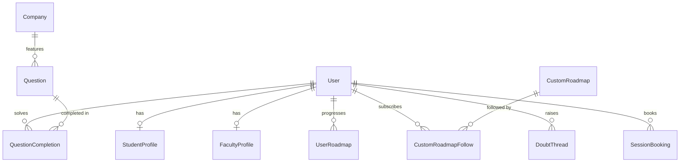

# Schema & Data Models

This directory documents the data schemas, entity models, and topic taxonomies used throughout PlacePrep.

---

## Active Production Database: MongoDB Atlas (Mongoose)

PlacePrep's primary production database runs on **MongoDB Atlas** managed via **Mongoose** models located in [`backend/src/models/`](file:///Users/sourabhsarkarmacois/Desktop/Place_Prep_Sourabh/backend/src/models).

### Core Models

| Model | File | Description |
|---|---|---|
| `User` | [`User.ts`](file:///Users/sourabhsarkarmacois/Desktop/Place_Prep_Sourabh/backend/src/models/User.ts) | Core user authentication record (email, password hash, role: `student` \| `faculty` \| `admin`, googleId, avatar picture, status). |
| `StudentProfile` | [`StudentProfile.ts`](file:///Users/sourabhsarkarmacois/Desktop/Place_Prep_Sourabh/backend/src/models/StudentProfile.ts) | Student metadata: batch, branch, self-ratings, daily goal, total XP, streak, and external platform handles (`leetcode`, `codeforces`). |
| `FacultyProfile` | [`FacultyProfile.ts`](file:///Users/sourabhsarkarmacois/Desktop/Place_Prep_Sourabh/backend/src/models/FacultyProfile.ts) | Faculty metadata: department, designation, office hours, areas of expertise. |
| `Question` | [`Question.ts`](file:///Users/sourabhsarkarmacois/Desktop/Place_Prep_Sourabh/backend/src/models/Question.ts) | Question pool (22,750+ questions). Includes companySlug, problem summary, difficulty (`Easy`/`Medium`/`Hard`), roundType, topics, LeetCode / external URLs, and MCQ choices. |
| `Company` | [`Company.ts`](file:///Users/sourabhsarkarmacois/Desktop/Place_Prep_Sourabh/backend/src/models/Company.ts) | 670+ company entities with hiring patterns, interview rounds, tier, logo URL, and hiring statistics. |
| `UserRoadmap` | [`UserRoadmap.ts`](file:///Users/sourabhsarkarmacois/Desktop/Place_Prep_Sourabh/backend/src/models/UserRoadmap.ts) | Personalized student curricula generated from self-assessment ratings (`frequency × weakness`) with weekly problem schedules. |
| `CustomRoadmap` | [`CustomRoadmap.ts`](file:///Users/sourabhsarkarmacois/Desktop/Place_Prep_Sourabh/backend/src/models/CustomRoadmap.ts) | Faculty-authored curricula spanning multiple companies, custom week organization, external questions, and publish/retire states. |
| `CustomRoadmapFollow` | [`CustomRoadmapFollow.ts`](file:///Users/sourabhsarkarmacois/Desktop/Place_Prep_Sourabh/backend/src/models/CustomRoadmapFollow.ts) | Tracks student subscriptions to custom roadmaps. |
| `QuestionCompletion` | [`QuestionCompletion.ts`](file:///Users/sourabhsarkarmacois/Desktop/Place_Prep_Sourabh/backend/src/models/QuestionCompletion.ts) | Records student problem solves, XP awarded, and live platform verification status (`verifiedViaPlatform: boolean`). |
| `DoubtThread` | [`DoubtThread.ts`](file:///Users/sourabhsarkarmacois/Desktop/Place_Prep_Sourabh/backend/src/models/DoubtThread.ts) | Threaded doubt resolution between students and faculty. |
| `SessionBooking` | [`SessionBooking.ts`](file:///Users/sourabhsarkarmacois/Desktop/Place_Prep_Sourabh/backend/src/models/SessionBooking.ts) | 1-on-1 mentorship and mock interview session scheduling. |
| `CurriculumTopic` | [`CurriculumTopic.ts`](file:///Users/sourabhsarkarmacois/Desktop/Place_Prep_Sourabh/backend/src/models/CurriculumTopic.ts) | Academic syllabus topics used for faculty curriculum gap intelligence. |
| `FeatureFlag` | [`FeatureFlag.ts`](file:///Users/sourabhsarkarmacois/Desktop/Place_Prep_Sourabh/backend/src/models/FeatureFlag.ts) | System-wide toggles managed by administrators. |

---

## Topic Taxonomy

Questions and curriculum mappings follow a standardized topic taxonomy across four domains:

| Category | Topics |
|---|---|
| **Data Structures & Algorithms** | Arrays, Strings, Two Pointers, Sliding Window, Linked Lists, Stacks & Queues, Trees, Binary Search Trees, Graphs, Dynamic Programming, Greedy, Backtracking, Bit Manipulation, Math |
| **Core Computer Science** | Operating Systems, Database Management Systems (DBMS), Computer Networks, Object-Oriented Programming (OOP), System Design (HLD/LLD) |
| **Domain Technologies** | Machine Learning, Deep Learning, SQL, Web Technologies, Cloud Computing, DevOps |
| **Behavioral & HR** | Leadership Principles, STAR Method Questions, Problem Solving, Project Walkthroughs |

---

## Relational Reference Model (SQL Archive)

During early prototyping, a relational PostgreSQL schema was drafted:
- [`migrations/`](file:///Users/sourabhsarkarmacois/Desktop/Place_Prep_Sourabh/schema/migrations): Contains historical SQL migration definitions (`001_create_companies.sql` through `007_create_syllabus_topics.sql`).
- [`seed/`](file:///Users/sourabhsarkarmacois/Desktop/Place_Prep_Sourabh/schema/seed): Seed data templates.

For all active development, use the Mongoose schemas defined in `backend/src/models/`.
